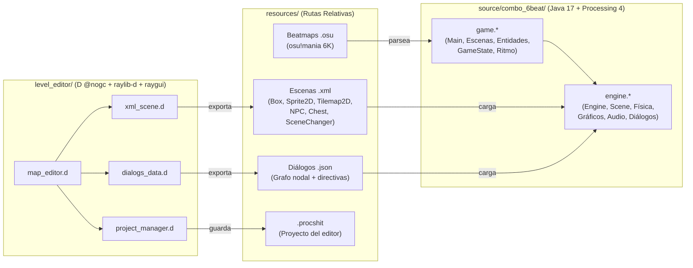
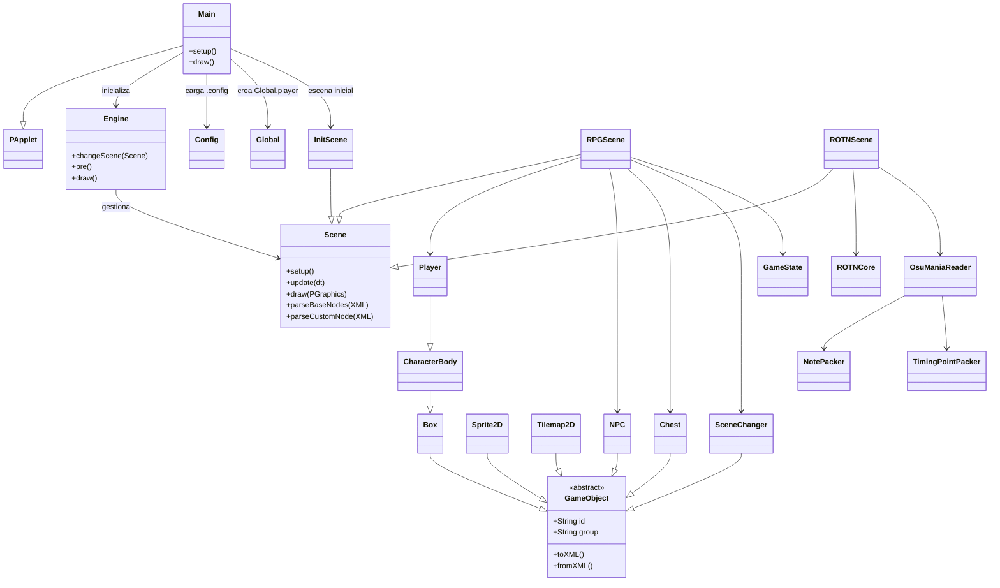
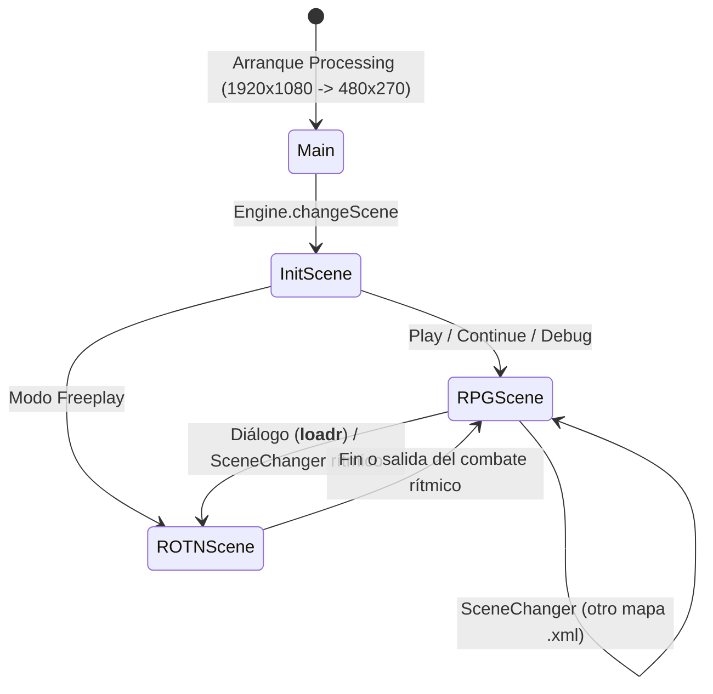

# Arquitectura del Código — Combo 6Beat

> [!tip] Vista Interactiva en Obsidian
> Abre el archivo visual [[Arquitectura_Codigo_Combo6Beat.canvas]] en Obsidian para explorar el grafo interactivo con nodos agrupados por paquete, colores y flechas de dependencias.

---

## 1. Panorama General del Proyecto

El proyecto se divide en un **editor nativo externo en D** (`level_editor/`), un **directorio de contratos/assets** (`resources/`) y el **juego en Java 17 + Processing 4** (`source/combo_6beat/`), el cual a su vez separa estrictamente el motor reutilizable (`engine.*`) de la lógica específica del juego (`game.*`).

---

## 2. Arquitectura de Clases Java (`engine.*` vs `game.*`)

Regla clave del proyecto: **`engine.*` nunca importa `game.*`**. Toda especialización ocurre por herencia (`extends Scene`, `extends GameObject`, `extends CharacterBody`) o carga por reflexión (`ResourcesManager.loadCustomObject`).

---

## 3. Flujo de Escenas y Ciclo de Vida

---

## 4. Mapa Rápido de Paquetes

| Paquete / Módulo | Rol Principal | Archivos Clave |
| :--- | :--- | :--- |
| `game` | Entrada, configuración y estado global | [Main.java](file:///home/sar/Documentos/Combo%206Beat/source/combo_6beat/src/main/java/game/Main.java), [Config.java](file:///home/sar/Documentos/Combo%206Beat/source/combo_6beat/src/main/java/game/Config.java), [Global.java](file:///home/sar/Documentos/Combo%206Beat/source/combo_6beat/src/main/java/game/Global.java) |
| `game.core` | Estado persistente, inventario, power-ups, guardado | [GameState.java](file:///home/sar/Documentos/Combo%206Beat/source/combo_6beat/src/main/java/game/core/GameState.java) |
| `game.scenes` | Menú, exploración RPG y combate rítmico 6K | [InitScene.java](file:///home/sar/Documentos/Combo%206Beat/source/combo_6beat/src/main/java/game/scenes/InitScene.java), [RPGScene.java](file:///home/sar/Documentos/Combo%206Beat/source/combo_6beat/src/main/java/game/scenes/RPGScene.java), [ROTNScene.java](file:///home/sar/Documentos/Combo%206Beat/source/combo_6beat/src/main/java/game/scenes/ROTNScene.java), [ROTNCore.java](file:///home/sar/Documentos/Combo%206Beat/source/combo_6beat/src/main/java/game/scenes/ROTNCore.java) |
| `game.core.game_objects` | Entidades interactivas del mundo RPG | [Player.java](file:///home/sar/Documentos/Combo%206Beat/source/combo_6beat/src/main/java/game/core/game_objects/Player.java), [NPC.java](file:///home/sar/Documentos/Combo%206Beat/source/combo_6beat/src/main/java/game/core/game_objects/NPC.java), [Chest.java](file:///home/sar/Documentos/Combo%206Beat/source/combo_6beat/src/main/java/game/core/game_objects/Chest.java), [SceneChanger.java](file:///home/sar/Documentos/Combo%206Beat/source/combo_6beat/src/main/java/game/core/game_objects/SceneChanger.java) |
| `game.core.notes` | Lectura de `.osu` y empaquetado bitwise en `long` | [OsuManiaReader.java](file:///home/sar/Documentos/Combo%206Beat/source/combo_6beat/src/main/java/game/core/notes/OsuManiaReader.java), [NotePacker.java](file:///home/sar/Documentos/Combo%206Beat/source/combo_6beat/src/main/java/game/core/notes/NotePacker.java), [TimingPointPacker.java](file:///home/sar/Documentos/Combo%206Beat/source/combo_6beat/src/main/java/game/core/notes/TimingPointPacker.java) |
| `engine` | Loop principal, escena base, recursos, teclado | [Engine.java](file:///home/sar/Documentos/Combo%206Beat/source/combo_6beat/src/main/java/engine/Engine.java), [Scene.java](file:///home/sar/Documentos/Combo%206Beat/source/combo_6beat/src/main/java/engine/Scene.java), [ResourcesManager.java](file:///home/sar/Documentos/Combo%206Beat/source/combo_6beat/src/main/java/engine/ResourcesManager.java), [KBInput.java](file:///home/sar/Documentos/Combo%206Beat/source/combo_6beat/src/main/java/engine/KBInput.java) |
| `engine.draw` & `physics` | Render 2D, cámara, tilemaps y colisiones AABB | [Sprite2D.java](file:///home/sar/Documentos/Combo%206Beat/source/combo_6beat/src/main/java/engine/draw/Sprite2D.java), [Tilemap2D.java](file:///home/sar/Documentos/Combo%206Beat/source/combo_6beat/src/main/java/engine/draw/Tilemap2D.java), [Camera2D.java](file:///home/sar/Documentos/Combo%206Beat/source/combo_6beat/src/main/java/engine/draw/Camera2D.java), [CharacterBody.java](file:///home/sar/Documentos/Combo%206Beat/source/combo_6beat/src/main/java/engine/physics/CharacterBody.java) |
| `engine.audio` & `dialogs` | SFX/BGM y sistema de diálogos JSON | [Audio.java](file:///home/sar/Documentos/Combo%206Beat/source/combo_6beat/src/main/java/engine/audio/Audio.java), [MusicTrack.java](file:///home/sar/Documentos/Combo%206Beat/source/combo_6beat/src/main/java/engine/audio/MusicTrack.java), [DialogManager.java](file:///home/sar/Documentos/Combo%206Beat/source/combo_6beat/src/main/java/engine/dialogs/DialogManager.java) |
| `level_editor` (D) | Editor externo de escenas XML, diálogos JSON y tilemaps | [map_editor.d](file:///home/sar/Documentos/Combo%206Beat/level_editor/source/scenes/map_editor/map_editor.d), [xml_scene.d](file:///home/sar/Documentos/Combo%206Beat/level_editor/source/scenes/map_editor/xml_scene.d), [dialogs_data.d](file:///home/sar/Documentos/Combo%206Beat/level_editor/source/scenes/map_editor/dialogs_data.d) |
