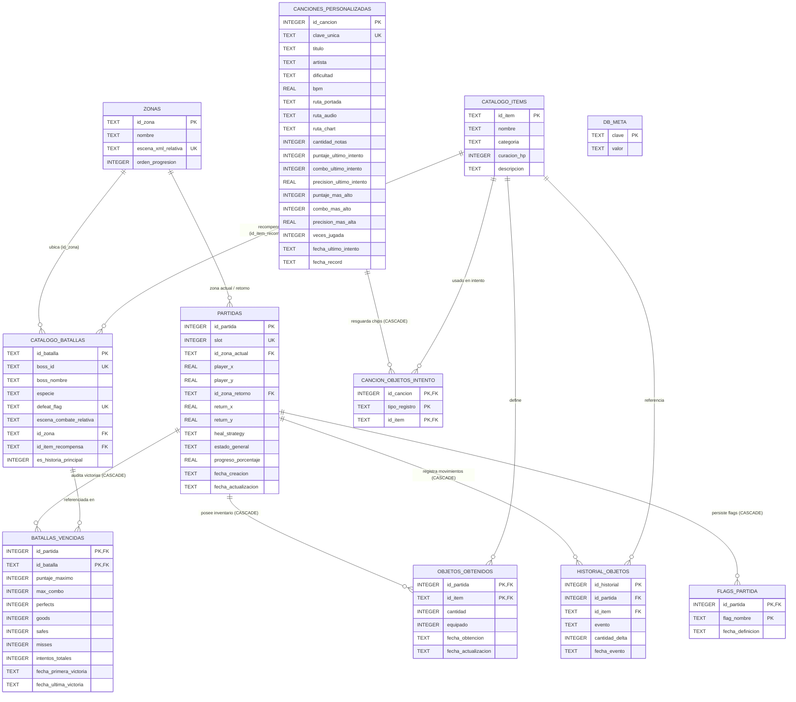

# Diagrama Entidad-Relación (DER) — Base de Datos SQLite (*Combo 6Beat*)

> [!tip] Archivos del DER (Notación Chen)
> - **Imagen alta resolución (PNG):** [[DER_BaseDeDatos_Combo6Beat.png]]
> - **Vectorial (SVG):** [[DER_BaseDeDatos_Combo6Beat.svg]]
> - **Editable (draw.io / diagrams.net):** [DER_BaseDeDatos_Combo6Beat.drawio](file:///home/sar/Documentos/Combo%206Beat/arquitectura/DER_BaseDeDatos_Combo6Beat.drawio)
> - **Obsidian Canvas:** [[DER_BaseDeDatos_Combo6Beat.canvas]]
>
> 

---

## 1. Diagrama Entidad-Relación (Mermaid `erDiagram`)

---

## 2. Justificación de Tercera Forma Normal (3FN)

1. **1FN (Atributos atómicos):** Todas las columnas almacenan valores indivisibles. Los objetos usados en el último intento y los resguardados del récord en `CANCIONES_PERSONALIZADAS` no se guardan como listas de texto sino en la tabla `CANCION_OBJETOS_INTENTO` con clave `(id_cancion, tipo_registro, id_item)`.
2. **2FN (Dependencia funcional completa):** En las tablas con clave primaria compuesta (`BATALLAS_VENCIDAS`, `OBJETOS_OBTENIDOS`, `FLAGS_PARTIDA`, `CANCION_OBJETOS_INTENTO`), cada atributo no clave depende de toda la clave compuesta y no de una parte de ella.
3. **3FN (Sin dependencias transitivas):** Los datos descriptivos estáticos de mapas (`ZONAS`), objetos (`CATALOGO_ITEMS`) y jefes (`CATALOGO_BATALLAS`) residen en catálogos propios referenciados por clave foránea, evitando redundancia dentro de `PARTIDAS`, `OBJETOS_OBTENIDOS` y `BATALLAS_VENCIDAS`.

---

## 3. Archivos Relacionados
- Esquema SQL reproducible: [schema.sql](file:///home/sar/Documentos/Combo%206Beat/source/combo_6beat/resources/db/schema.sql)
- Gestor JDBC y migración: [DatabaseManager.java](file:///home/sar/Documentos/Combo%206Beat/source/combo_6beat/src/main/java/game/core/db/DatabaseManager.java)
- Repositorio de partidas/batallas/inventario: [SaveRepository.java](file:///home/sar/Documentos/Combo%206Beat/source/combo_6beat/src/main/java/game/core/db/SaveRepository.java)
- Repositorio de canciones custom: [CustomSongRepository.java](file:///home/sar/Documentos/Combo%206Beat/source/combo_6beat/src/main/java/game/core/db/CustomSongRepository.java)
