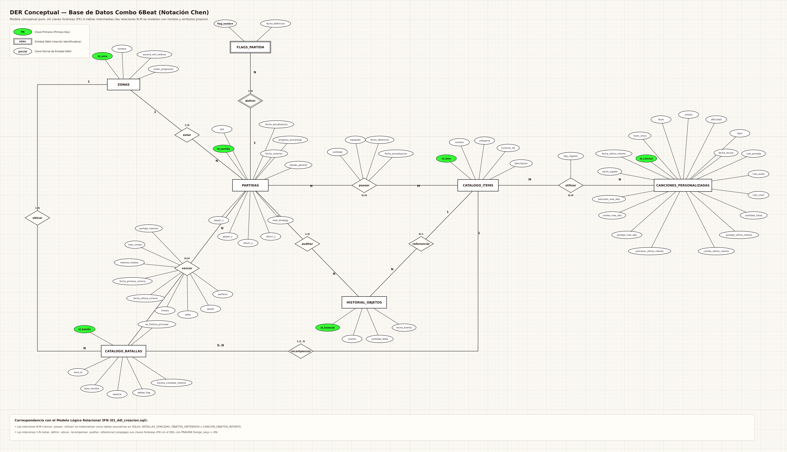

# Documentación del Proyecto Final Integrador — *Combo 6Beat*

| Campo | Detalle |
| :--- | :--- |
| **Institución** | Escuela Técnica Nº 35 D.E. 18 «Ing. Eduardo Latzina» |
| **Orientación** | Automotores — Computación |
| **Proyecto** | *Combo 6Beat* (Videojuego 2D RPG / Rítmico 6K + Editor de Niveles + Persistencia SQLite 3FN) |
| **Alumno** | Francisco Nahuel Sarmiento (5º 4ª) |
| **Docente** | Juan Manuel Moya |
| **Ciclo Lectivo** | 2026 |
| **Motor de Base de Datos** | SQLite 3 (`org.xerial:sqlite-jdbc:3.54.1.0`) |

---

## 1. Resumen Ejecutivo y Propuesta

***Combo 6Beat*** es un videojuego 2D con estética *pixel art* que combina **exploración RPG en vista top-down** (inspirada en *Everhood*) con **combate rítmico de 6 carriles** (inspirado en *Rift of the NecroDancer*). Como plataforma integral de desarrollo, el proyecto comprende dos aplicaciones coordinadas mediante archivos con **rutas relativas**:

1. **Runtime del juego (`source/combo_6beat/`):** Escrito en Java 17 sobre Processing 4.5.7, ControlP5, TinySound y SQLite JDBC.
2. **Editor de niveles externo (`level_editor/`):** Herramienta nativa en lenguaje D (`@nogc nothrow`) con `raylib-d` y `raygui` para diseñar escenarios XML, tilemaps, colisiones y grafos de diálogo JSON sin acoplar código de edición al ejecutable del juego.

En su vertiente de **Administración y Gestión de Bases de Datos (AGBA)**, el sistema reemplaza los antiguos guardados planos por una base de datos relacional **SQLite en Tercera Forma Normal (3FN)** que gobierna de manera unificada las partidas de historia (4 ranuras), inventario, auditoría histórica de ítems, batallas vencidas, flags narrativos y un módulo independiente de canciones personalizadas `.osu`.

---

## 2. Objetivos y Alcance del Sistema

- **Desacoplamiento Motor / Juego:** Mantener un motor 2D reutilizable (`engine.*`) sin dependencias hacia la lógica específica del título (`game.*`).
- **Hibridación RPG + Ritmo 6K:** Integrar exploración top-down (`560x315` virtual RPG) con enfrentamientos musicales de 6 carriles (`480x270` virtual de combate) que conservan recompensas, inventario, PowerUps y progreso narrativo en una misma sesión.
- **Persistencia Relacional Robusta (3FN):** Garantizar integridad referencial (`PRAGMA foreign_keys = ON`), unicidad de métricas, trazabilidad histórica en `HISTORIAL_OBJETOS` y resguardo automático de récords e ítems mediante triggers SQLite.
- **Separación de Modos de Juego:** Mantener los jefes de la campaña historia separados del reproductor e importador de pistas custom `.osu`, permitiendo explorar y superar récords propios sin contaminar el progreso de una partida guardada.

---

## 3. Mecánicas de Juego y Reglas del Dominio

### 3.1 Exploración Top-Down y Progresión de Historia
El jugador recorre áreas conectadas por escenas XML (`hub.xml`, `swamp.xml`, `beach_ruins.xml`), interactúa con NPCs mediante grafos de diálogo JSON (`RPGDialog`), recoge cofres (`Chest`) e ítems, equipa mejoras y accede en cualquier momento al menú Teléfono/Pausa (`ESC`) para consultar estado, cambiar estrategia de curación, equipar objetos y guardar en BD.

La campaña principal se organiza en actos conectados mediante banderas narrativas (`FLAGS_PARTIDA`) y enfrentamientos clave (**7 batallas de historia principal** catalogadas en `CATALOGO_BATALLAS`, además de encuentros opcionales):

- **El Hub (`hub.xml`):** Zona central y punto de convergencia; alberga la batalla secreta final contra **La Gata** (`batalla_cat_7`) y la salida tras obtener la **Llave Virtual** (`key_exit`).
- **Swamp / Pantano (`swamp.xml`):** 3 batallas de historia (`batalla_swamp_1` Kael, `batalla_swamp_2` Kael & Vesper, `batalla_swamp_3` Grail), recompensas (`powerup_reaction_plus`, `potion_large`) y escondites/medallón del Pantano (`amulet_medallion_swamp`).
- **Beach / Playas y Ruinas (`beach_ruins.xml`):** 3 batallas de historia (`batalla_beach_1` Kael & Vesper, `batalla_beach_2` Kael & Vesper, `batalla_beach_3` Grail), recompensas (`potion_medium`, `amulet_healing`, `powerup_reaction_minus`) y medallón del Ocaso (`amulet_medallion_ruins`).
- **Estados de Partida:** `EN_PROGRESO`, `FINAL_NORMAL`, `FINAL_VERDADERO` y `BUCLE_AGOTADO` (activado al alcanzarse la condición narrativa `LOOP_EXHAUSTED_MODE`).

### 3.2 Combate Rítmico de 6 Carriles (`ROTNCore`)
- **Controles:** 6 carriles configurables (por defecto `Q, W, E, U, I, O` y esquema alternativo `A, S, D, J, K, L`).
- **Ventanas de Juicio (`ROTNCore.HitRating`):** Aunque la propuesta preliminar contemplaba umbrales más estrictos (`20 / 45 / 60 ms`), la implementación actual calibra las ventanas base en **`PERFECT` (45.0 ms), `GOOD` (85.0 ms), `SAFE` (125.0 ms) y `MISS` (170.0 ms)** para equilibrar la respuesta jugable.
- **Modificadores por PowerUps:**
  - `powerup_reaction_plus` (**Chip +10ms**): amplía la ventana de reacción en `+10 ms` (+25 pts de coste de curación).
  - `powerup_reaction_minus` (**Chip -7.5ms**): reduce la ventana en `-7.5 ms` (-20 pts de coste de curación).
  - `powerup_invincibility` (**Escudo Unico**): protección de un solo uso por pista.
- **Curación Dinámica y Estrategias:** El núcleo `ROTNCore` implementa curación por notas consecutivas acertadas (2 aciertos consecutivos recuperando **`50%` del daño recibido**, o **`75%`** al equipar `amulet_healing`), junto con el uso automático/manual de pociones configurado mediante `HealStrategy` (`OPTIMAL` / `MINIMAL`, `consumeAutoHeal`).

### 3.3 Selector de Pistas y Modo Canciones Custom (`.osu`)
En `InitScene.SONG_SELECT`, el usuario dispone de dos pestañas claramente separadas:
1. **`CANCIONES CUSTOM` (+ `+ IMPORTAR .OSU`):** Lista y permite importar archivos `.osu` (modo 6K) dentro de `resources/songs/custom/`. Sus métricas, BPM, portadas e ítems utilizados en el **último intento** vs. **récord** se persisten de forma independiente en SQLite (`CANCIONES_PERSONALIZADAS` y `CANCION_OBJETOS_INTENTO`).
2. **`JEFES HISTORIA`:** Permite practicar enfrentamientos de la historia (`CATALOGO_BATALLAS`) sin alterar las ranuras de guardado de la campaña.

---

## 4. Arquitectura del Software (Visión Modular)

La solución Java adopta una **arquitectura POO en 4 capas** ([ver detalle completo en Arquitectura_Capas_POO.md](../03_codigo_fuente/Arquitectura_Capas_POO.md)):

| Capa | Paquete Java | Responsabilidad |
| :--- | :--- | :--- |
| **Presentación / Escenas** | `game.*`, `game.scenes.*` | `Main` (`PApplet`), `Config`, `Global`, `InitScene`, `RPGScene`, `ROTNScene`, `ROTNCore`. |
| **Dominio** | `game.core.*` | `GameState`, `Player`, `NPC`, `Chest`, `SceneChanger`, `RPGDialog`, `OsuManiaReader`. |
| **Persistencia SQLite** | `game.core.db.*` | `DatabaseManager`, `SaveRepository`, `CustomSongRepository` sobre `resources/db/schema.sql`. |
| **Motor Reutilizable** | `engine.*` | `Engine`, `Scene`, `ResourcesManager`, `KBInput`, `GameObject`, `Box`, `CharacterBody`, `Tilemap2D`, `Sprite2D`, `Camera2D`, `ParticleSystem`, `Audio`, `GameDialog`. |

A esta estructura se suma **`level_editor/`** en lenguaje D (`@nogc nothrow`), encargado exclusivamente de construir escenas XML, tilesets y diálogos JSON con rutas relativas.

---

## 5. Diseño de Base de Datos (AGBA — SQLite 3FN)

### 5.1 Diagrama Entidad–Relación Conceptual (Chen Puro)
Siguiendo estrictamente la notación Chen conceptual, el diagrama siguiente **no incluye claves foráneas (`FK`) ni tablas intermedias**: las asociaciones muchos-a-muchos (`vencer`, `poseer`, `utilizar`) se representan como **rombos con atributos propios**, y **`FLAGS_PARTIDA`** se modela como **entidad débil** (doble rectángulo y clave parcial) vinculada a `PARTIDAS` mediante la relación identificadora **`definir` (`1:N`)**. Los atributos clave primaria (`PK`) se destacan en verde (`#33FF33`).

*(Fuentes editables en [DER_Conceptual_Combo6Beat.drawio](../02_base_de_datos/DER_Conceptual_Combo6Beat.drawio), [DER_Conceptual_Combo6Beat.svg](../02_base_de_datos/DER_Conceptual_Combo6Beat.svg) y [DER_Conceptual_Combo6Beat.canvas](../02_base_de_datos/DER_Conceptual_Combo6Beat.canvas).)*

### 5.2 Transformación al Modelo Lógico Relacional (3FN)
Al traducir el DER conceptual al esquema físico SQLite ([01_ddl_creacion.sql](../02_base_de_datos/01_ddl_creacion.sql)), el diseño cumple **1FN** (atributos atómicos sin listas serializadas), **2FN** (dependencia funcional completa respecto a toda clave primaria compuesta) y **3FN** (eliminación de dependencias transitivas mediante tablas de catálogo `ZONAS`, `CATALOGO_ITEMS` y `CATALOGO_BATALLAS`).

El detalle completo de transformación y diccionario de datos se encuentra en [Modelo_Relacional_3FN.md](../02_base_de_datos/Modelo_Relacional_3FN.md), e incluye:
- **11 tablas:** `DB_META`, `ZONAS`, `CATALOGO_ITEMS`, `CATALOGO_BATALLAS`, `PARTIDAS`, `BATALLAS_VENCIDAS`, `OBJETOS_OBTENIDOS`, `HISTORIAL_OBJETOS`, `FLAGS_PARTIDA`, `CANCIONES_PERSONALIZADAS`, `CANCION_OBJETOS_INTENTO`.
- **3 índices** de consulta (`idx_historial_partida_fecha`, `idx_batallas_vencidas_partida`, `idx_canciones_custom_titulo`).
- **10 triggers** automáticos:
  - Validación de integridad semántica (`trg_canciones_validar_insert/update`, `trg_objetos_validar_insert/update`: `bpm > 0`, puntajes no negativos, prohibición de rutas absolutas, `cantidad >= 0`).
  - Promoción de récords e ítems en canciones personalizadas (`trg_canciones_record_after_insert/update`: actualiza `puntaje_mas_alto`, `combo_mas_alto`, `precision_mas_alta`, `fecha_record` y copia el set de objetos `'ULTIMO'` → `'MEJOR'` en `CANCION_OBJETOS_INTENTO` únicamente cuando el intento supera al récord vigente).
  - Auditoría de inventario (`trg_objetos_audit_insert/update`: registra `'OBTENIDO'`, `'USADO'`, `'EQUIPADO'` y `'DESEQUIPADO'` en `HISTORIAL_OBJETOS`).
  - Progreso de campaña (`trg_batallas_progreso_insert/update`: recalcula `progreso_porcentaje` en `PARTIDAS`).
- **6 vistas (`INNER JOIN`)** listas para reportes y defensa en vivo: `v_resumen_partidas`, `v_mejores_puntajes_batallas`, `v_inventario_detallado`, `v_historial_objetos`, `v_canciones_custom_objetos` y `v_estadisticas_canciones_custom`.

### 5.3 Scripts Entregables y Migración desde Archivos Heredados
El motor Java ejecuta `DatabaseManager.init()` al arrancar `Main`, creando o verificando `combo6beat.db` en modo WAL con `PRAGMA foreign_keys = ON`. Si detecta archivos heredados `.save` / `.save2`, realiza una **migración única** controlada por `DB_META ('legacy_saves_migrated')`, convirtiendo SQLite en la única fuente de verdad del juego.

Los scripts independientes de creación, datos de ejemplo, reportes y respaldo `.sql` completo se ubican en [../02_base_de_datos/](../02_base_de_datos/).

---

## 6. Estado Actual y Próximos Pasos del Videojuego

- **Completado y verificado:**
  - Base de datos SQLite 3FN completa (`schema.sql`), scripts DDL/DML/Consultas/Respaldo y DER Conceptual Chen.
  - Repositorios JDBC (`DatabaseManager`, `SaveRepository`, `CustomSongRepository`) integrados en `GameState`, `Main`, `RPGScene`, `ROTNCore`, `ROTNScene` e `InitScene`.
  - Menú principal completo (`MAIN`, `SAVE_SELECT` de 4 ranuras, `SONG_SELECT` con 2 pestañas + importador `.osu`, y `SETTINGS` con audio, resolución `1080p`/`720p`, pixel-perfect y rebinding de teclas).
  - Editor de niveles nativo en D (`level_editor/`) compilando correctamente, junto con escenas XML (`hub.xml`, `swamp.xml`, `beach_ruins.xml`), 7 batallas de historia y 2 pistas custom `.osu` de muestra.
- **En desarrollo activo (pendiente para el cierre definitivo del juego):**
  - Arte y animaciones *pixel art* definitivas para personajes/jefes y ambientación.
  - Pulido final de diálogos, secuencias de cierre de campaña y empaquetado distribuible final de `source/combo_6beat/` en [../03_codigo_fuente/](../03_codigo_fuente/).
