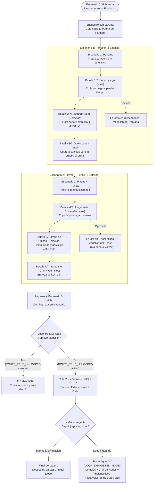

# Índice y Arquitectura Narrativa — *Combo 6Beat*

Este directorio organiza toda la narrativa de **Combo 6Beat** manteniendo una **separación estricta entre la Historia** (biblia de mundo, arcos de personajes y escaleta de progreso) y los **Borradores de Diálogos** (guiones literarios editables y grafos JSON compatibles con `DialogManager` y `level_editor`).

---

## 1. Estructura de Archivos

### A. Historia (Diseño Narrativo y Lore)
- [01_HISTORIA_Y_PERSONAJES.md](file:///home/sar/Documentos/Combo%206Beat/docs/story/01_HISTORIA_Y_PERSONAJES.md) — Premisa (*"El Compás Prestado"*), reglas de la simulación, temas y fichas de personaje (Protagonista, La Gata, Los Gemelos *Kael & Vesper*, Grail).
- [02_ESCALETA_ESCENARIOS_Y_RUTAS.md](file:///home/sar/Documentos/Combo%206Beat/docs/story/02_ESCALETA_ESCENARIOS_Y_RUTAS.md) — Progresión detallada por escenario (Hub, Pantano, Playas + Ruinas), las 7 batallas (3 + 3 + 1 extra), escondites móviles de La Gata, Medallones, las 2 rutas finales y el modo post-juego de *NPCs cansados*.

### B. Borradores de Diálogos (Guion Literario + Grafos JSON)
- **Guiones literarios (borradores para revisar tono y ritmo):**
  - [00_BORRADOR_DIALOGOS_HUB.md](file:///home/sar/Documentos/Combo%206Beat/docs/story/dialogs_drafts/00_BORRADOR_DIALOGOS_HUB.md)
  - [01_BORRADOR_DIALOGOS_PANTANO.md](file:///home/sar/Documentos/Combo%206Beat/docs/story/dialogs_drafts/01_BORRADOR_DIALOGOS_PANTANO.md)
  - [02_BORRADOR_DIALOGOS_PLAYAS_RUINAS.md](file:///home/sar/Documentos/Combo%206Beat/docs/story/dialogs_drafts/02_BORRADOR_DIALOGOS_PLAYAS_RUINAS.md)
- **Grafos JSON borradores (`source/combo_6beat/resources/dialogs/`):**
  - [draft_hub.json](file:///home/sar/Documentos/Combo%206Beat/source/combo_6beat/resources/dialogs/draft_hub.json)
  - [draft_swamp.json](file:///home/sar/Documentos/Combo%206Beat/source/combo_6beat/resources/dialogs/draft_swamp.json)
  - [draft_beach_ruins.json](file:///home/sar/Documentos/Combo%206Beat/source/combo_6beat/resources/dialogs/draft_beach_ruins.json)

---

## 2. Mapa de Flujo General (Escenarios, Batallas y Rutas)

---

## 3. Contrato Técnico de Escenas, Canciones, Ítems y Flags

### 3.1. Escenas XML (Proyectadas y Existentes)

| Escenario | Archivo XML | Archivo de Diálogo (Borrador) | Notas |
| :--- | :--- | :--- | :--- |
| **Escenario 0 (Hub)** | `resources/scenes/hub.xml` *(por construir)* | `dialogs/draft_hub.json` | Spawn inicial e interfaz de salida |
| **Escenario 1 (Pantano)** | `resources/scenes/swamp.xml` *(por construir)* | `dialogs/draft_swamp.json` | Primer escenario principal (3 batallas) |
| **Escenario 2 (Playas + Ruinas)** | `resources/scenes/beach_ruins.xml` *(existente)* | `dialogs/draft_beach_ruins.json` | Segundo escenario principal (3 batallas) |

### 3.2. Mapa de las 7 Batallas (`.scene` + `.osu`)

| # | Escenario | Jefe / Rival | Título Provisorio | `.scene` (Existente / Proyectado) | Flag de Derrota (`defeat-flag`) |
| :-: | :--- | :--- | :--- | :--- | :--- |
| 1 | Pantano (1/3) | **Kael** (Gemelo 1) | *Peaje de Lodo* | `resources/songs/swamp_1_kael.scene` *(proyectado; placeholder temporal: `fiend - 2DF2.scene`)* | `BOSS_SWAMP_1_DEFEATED` |
| 2 | Pantano (2/3) | **Vesper & Kael** (Gemelos) | *Doble Capricho en la Bruma* | `resources/songs/swamp_2_twins.scene` *(proyectado; placeholder temporal: `nash_storm.scene`)* | `BOSS_SWAMP_2_DEFEATED` |
| 3 | Pantano (3/3) | **Grail** (Oso-Búho) | *Bajo las Plumas del Vigía* | `resources/songs/swamp_3_grail.scene` *(proyectado; placeholder temporal: `grail_sanctum.scene`)* | `BOSS_SWAMP_3_DEFEATED` |
| 4 | Playas + Ruinas (1/3) | **Kael & Vesper** (Costa) | *Marea de Cristal* | `resources/songs/beach_1_twins.scene` *(proyectado; placeholder temporal: `nash_storm.scene`)* | `BOSS_BEACH_1_DEFEATED` |
| 5 | Playas + Ruinas (2/3) | **Kael & Vesper** (Ruinas) | *Vals de Cuernos y Colmillos* | `resources/songs/beach_2_twins.scene` *(proyectado; placeholder temporal: `fiend - 2DF2.scene`)* | `BOSS_BEACH_2_DEFEATED` |
| 6 | Playas + Ruinas (3/3) | **Grail** (Santuario) | *Juramento del Santuario* | `resources/songs/grail_sanctum.scene` *(existente)* | `BOSS_BEACH_3_DEFEATED` |
| 7 | Hub Final (Extra) | **La Gata** | *Ronroneo en el Fin del Mundo* | `resources/songs/glass beach.scene` *(existente, boss `boss_cat`)* | `BOSS_CAT_FINAL_DEFEATED` |

### 3.3. Catálogo de Ítems y Flags de Historia

#### Ítems de Historia (`GameState.java`)
- `amulet_medallion_swamp`: **Medallón del Pantano** — Entregado al encontrar a La Gata en su 3.er escondite del Pantano.
- `amulet_medallion_ruins`: **Medallón del Ocaso** — Entregado al encontrar a La Gata en su 3.er escondite de Playas + Ruinas.
- `key_exit`: **Llave Virtual** *(ya registrada en `GameState.java`)* — Entregada tras vencer a Grail en la Batalla 6 del Santuario.

#### Flags Globales (`__define__` / `__ifdef__` / `__ifndef__`)
| Flag | Quién lo define | Función en el flujo |
| :--- | :--- | :--- |
| `HUB_INTRO_DONE` | Hub (`draft_hub.json`) | Marca que La Gata ya guió al protagonista hacia la puerta del Pantano. |
| `SWAMP_ENTERED` | Pantano (`draft_swamp.json`) | Marca llegada al primer escenario. |
| `CAT_SWAMP_1`, `CAT_SWAMP_2`, `CAT_SWAMP_3` | Pantano (`draft_swamp.json`) | Controlan la aparición móvil de La Gata en 3 puntos del Pantano. |
| `SWAMP_MEDALLION_TAKEN` | Pantano (`draft_swamp.json`) | Se define al recoger `amulet_medallion_swamp` con La Gata. |
| `BOSS_SWAMP_1_DEFEATED`, `BOSS_SWAMP_2_DEFEATED`, `BOSS_SWAMP_3_DEFEATED` | Batallas 1, 2 y 3 | Desbloquean progresivamente la puerta del Pantano hacia Playas + Ruinas (`BOSS_SWAMP_3_DEFEATED`). |
| `CAT_RUINS_1`, `CAT_RUINS_2`, `CAT_RUINS_3` | Playas + Ruinas (`draft_beach_ruins.json`) | Controlan la aparición móvil de La Gata en 3 puntos de Playas + Ruinas. |
| `RUINS_MEDALLION_TAKEN` | Playas + Ruinas (`draft_beach_ruins.json`) | Se define al recoger `amulet_medallion_ruins` con La Gata. |
| `ROUTE_TRUE_UNLOCKED` | Playas + Ruinas (`draft_beach_ruins.json`) | Se activa cuando el jugador encontró a La Gata y obtuvo el Medallón (habilita la Ruta 2 / Batalla 7 en el Hub). |
| `BOSS_BEACH_1_DEFEATED`, `BOSS_BEACH_2_DEFEATED`, `BOSS_BEACH_3_DEFEATED` | Batallas 4, 5 y 6 | Marcan la progresión en Playas + Ruinas y habilitan la `key_exit` para regresar al Hub. |
| `BOSS_CAT_FINAL_DEFEATED` | Batalla 7 (Hub Final) | Marca que el protagonista superó la canción extra de La Gata. |
| `LOOP_EXHAUSTED_MODE` | Hub Final (`draft_hub.json`) | Se activa si el jugador elige **"Seguir jugando"** tras vencer a La Gata; cambia todos los diálogos de los Gemelos y Grail a su estado cansado. |
| `GAME_ENDING_NORMAL` / `GAME_ENDING_TRUE` | Hub Final (`draft_hub.json`) | Registran qué final alcanzó el jugador al cruzar la puerta de salida. |
